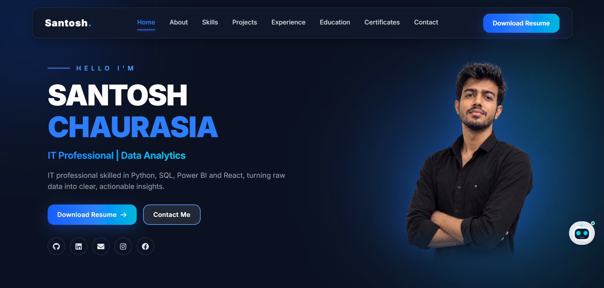
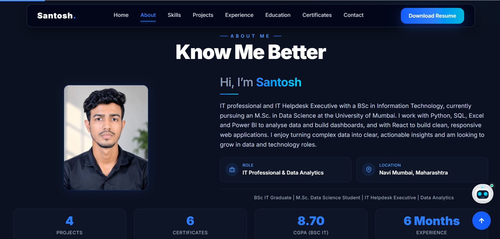
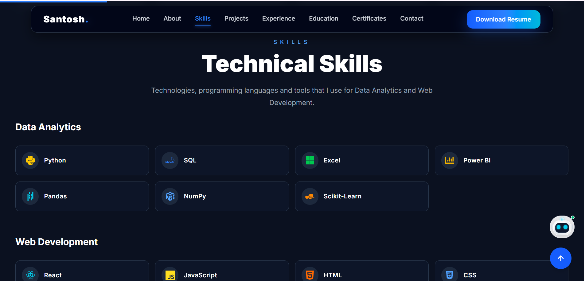
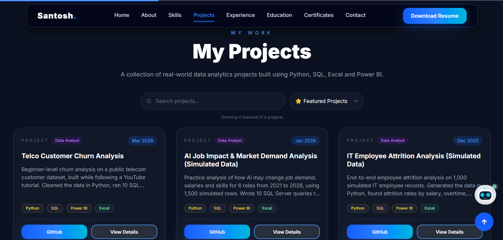
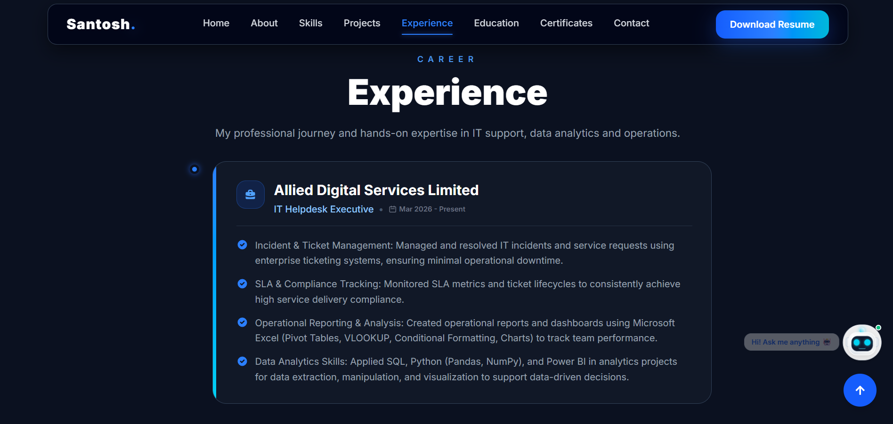
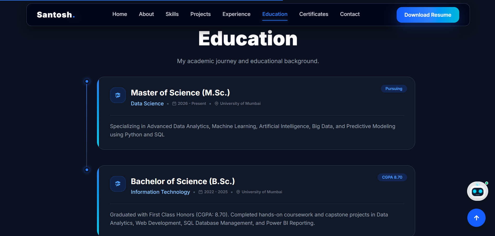
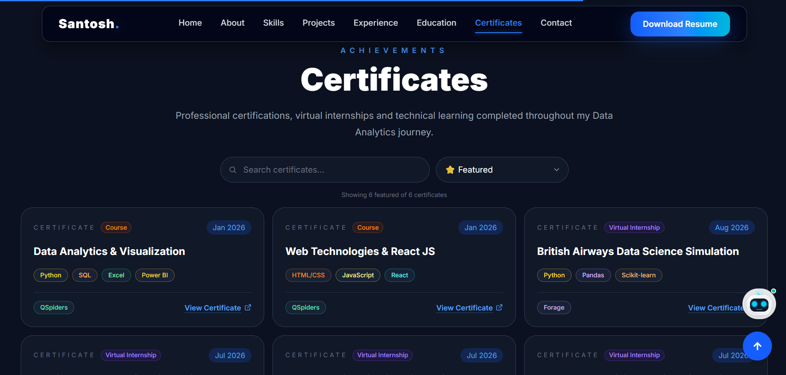
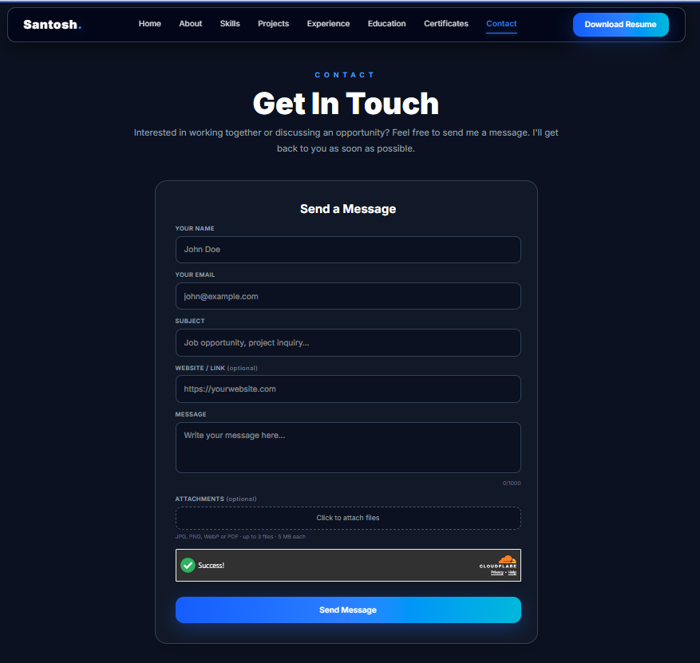
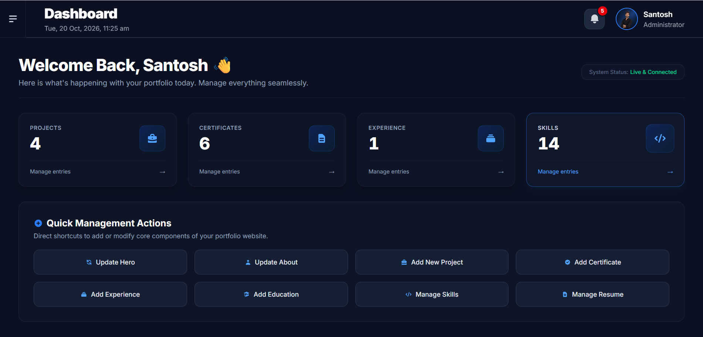

# Portfolio Website

This is my personal portfolio website. I made it to show my projects, skills, experience and certificates in one place. I built it while learning React and Firebase, and I use it in my job search for data analyst roles.

**Live website:** [santoshchaurasia.vercel.app](https://santoshchaurasia.vercel.app)

> **Note:** The source code of this project is private, because it is connected to my admin panel, database and API keys. This repo only has the project details and screenshots. I am happy to explain or show the code in an interview or on a call.

---

## Why I built this

- I wanted one place where recruiters can see my work.
- I did not want to edit the code every time I add a new project or certificate, so I made an admin panel to manage everything.
- I wanted to learn how a full website works, from the design to the database to the live deployment.

---

## Screenshots

### Home

### About

### Skills

### Projects

### Experience

### Education

### Certificates

### Contact form

### Admin dashboard (only I can open this)

---

## Features

### Visitor side
- Sections: Home, About, Skills, Projects, Experience, Education, Certificates and Contact
- Download Resume button
- Search and a Featured filter in the Projects and Certificates sections
- Projects and certificates show tags for the tools used
- Responsive design, which I tested on 7 screen sizes (from 375x667 phone to 1920x1080 desktop)
- Contact form with subject, optional website link and file attachments (up to 3 files, 5 MB each)
- Spam protection on the contact form using Cloudflare Turnstile
- "Santosh AI" chatbot, which answers questions about my portfolio using my portfolio data and the Gemini API

### Admin side (only for me)
- Secure admin login
- Add, edit and delete projects, certificates, experience, education and skills without changing the code
- Mark projects and certificates as Featured with a star
- Upload or replace the Hero photo, About photo and resume (with an image crop tool)
- Messages page to read contact form messages, mark them Pending or Replied, and a Spam folder
- Security alerts page to see failed login attempts and block or unblock an IP address
- Notification bell in the header for new messages and alerts

### Security
- Two-step login: password first, then a code from an authenticator app
- After 3 wrong login attempts, the IP address is blocked for some time and I get an alert
- Firebase security rules to protect the database
- API keys are kept on the server side (Vercel serverless functions), not in the browser

---

## Tech stack

| Area | Tools |
|------|-------|
| Frontend | React.js, Vite, Tailwind CSS, Framer Motion, React Icons |
| Database and login | Firebase Firestore, Firebase Authentication |
| File storage | Cloudinary (resume, photos, certificate files, message attachments) |
| AI chatbot | Gemini API |
| Backend | Vercel serverless functions |
| Contact form | Cloudflare Turnstile, Resend (email) |
| Hosting | Vercel |
| Version control | Git and GitHub |

---

## What I learned

- Building a React website with reusable components and Tailwind CSS
- Using Firebase Firestore and Authentication, and writing security rules
- Why API keys must not be kept in frontend code, and how to use serverless functions instead
- Making a layout responsive and testing it on many screen sizes
- Stopping spam in a contact form without blocking real users
- Deleting old unused files from Cloudinary when a photo or resume is replaced
- Some things worked on my laptop but failed after deploying to Vercel, so I learned to read the logs and fix them step by step

---

## Data projects shown in my portfolio

My portfolio has data analytics projects made with Python, SQL, Excel and Power BI. Projects with **(Simulated Data)** in the name are practice projects made with simulated data, and I have clearly written this in the project title. One project (Telco Customer Churn Analysis) was built while following a tutorial, and I have mentioned this in its description.

---

## About me

I am Santosh Chaurasia. I work as an IT Helpdesk Executive, I have a B.Sc. in Information Technology, and I am currently doing my M.Sc. in Data Science at the University of Mumbai. I am looking for Data Analyst opportunities.

---

## Contact

- Email: [amsantoshchaurasia@gmail.com](mailto:amsantoshchaurasia@gmail.com)
- LinkedIn: [linkedin.com/in/santoshchaurasia05](https://www.linkedin.com/in/santoshchaurasia05)
- GitHub: [github.com/santosh-chaurasia](https://github.com/santosh-chaurasia)
- Portfolio: [santoshchaurasia.vercel.app](https://santoshchaurasia.vercel.app)
